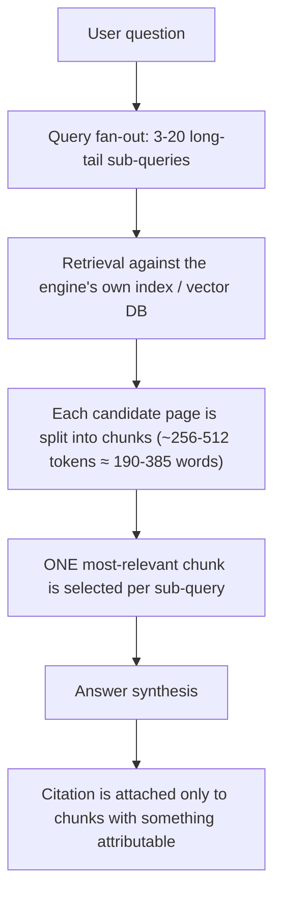

# AI Citation Audit — The Numbers That Decide If AI Cites Your Page

This guide defines a **quantitative** audit for AI citation readiness. It does not
measure "content quality" in the human sense. It measures whether a page is
**indexed where it matters**, **retrievable**, and **extractable** by the
retrieval-augmented (RAG) pipelines behind ChatGPT, Perplexity, Claude, Gemini,
Copilot, and Google AI Overviews.

Use it alongside — not instead of — `query-fanout.md` (how sub-queries are
generated), `rag-optimization.md` (chunk-friendly HTML mechanics),
`llm-citation-playbook.md`, `ai-overview-playbook.md`, and `geo.md`.

---

## 1. How an AI answer is actually built

Three consequences drive this entire audit:

1. **The page never competes as a page.** Each *chunk* competes independently for
   each fanned-out sub-query. A 2,000-word page with 6 headings has ~6-12 at-bats.
   The same content under 30 headings has ~30-40 at-bats.
2. **Retrieval and citation are two separate gates.** Relevance gets a chunk into
   the answer pool. Attributability (a stat, a quote, a source) is what makes the
   model *name* you instead of paraphrasing you and citing someone else.
3. **Search ranking is not the entry ticket — indexation is.** Pages that rank
   nowhere on Google are cited heavily; pages that rank well are often not cited
   at all (see §2.1). What correlates is being *indexed*, especially on Bing.

---

## 2. The prerequisites and the three numbers

| Check | Gate | What it governs |
|---|---|---|
| **0. Indexation (esp. Bing)** | Eligibility | Whether the page is in the pool an AI engine retrieves from at all |
| **1. Chunk density** — chunks per 1,000 words | Retrieval | How many sub-queries the page can compete for |
| **2. Chunk relevance score** — per chunk, per sub-query | Retrieval | Whether the chunk beats competing pages' chunks |
| **3. Extractable units per chunk** | Citation | Whether the model attributes the answer to you |

### 2.0 — Indexation, not ranking (the prerequisite everyone checks wrong)

Multiple datasets now show **little to no correlation between organic search
rank and AI citation volume**:

- A single-site 91-day experiment: the most-cited page ranked ~#40 on Google
  (1 click, 5,400+ citations); the best-ranking page (~#10, 294 clicks) got ~1,000
  citations. Across the site: ~31,700 AI citations vs ~456 Google clicks.
- An SEO Clarity analysis of ~1,000 top URLs ChatGPT cites found ~25% had **zero**
  Google organic visibility — and the more often a page was cited, the *less*
  likely it was to rank.

**What does gate eligibility: being indexed — and Bing indexation is the better
proxy.** ChatGPT/Copilot retrieval bootstrapped on Bing's index and still leans
on it. In the experiment above, Bing indexed 113–118 pages while Google indexed
41; the 25 Bing-only pages still carried ~6,200 citations.

**Audit actions:**
- Compare **Bing Webmaster Tools** indexed-page count vs **Google Search Console**
  indexed count. A large Google-only view understates reality.
- Flag any valuable page missing from Bing's index as a **High** finding — submit
  via Bing Webmaster URL submission / IndexNow.
- Do **not** treat poor Google rank as a reason to deprioritise a page for AI
  citation work. Rank and citation are close to statistically independent.

### 2.1 — Chunk density (chunks per 1,000 words)

**Definition of a chunk, for counting purposes:**
- One heading (`h2`–`h4`) **plus** its immediately following paragraph(s) up to the
  next heading = one chunk.
- Each standalone list (`ul` / `ol`) = one chunk.
- Each `table` = one chunk.
- A heading with no body text, or body text with no heading, is a **weak** chunk —
  count it but flag it.

**Heuristic bands** (calibrate per topic — see §3.2):

| Chunk density (per 1,000 words) | Reading |
|---|---|
| ≥ 25 | Strong — wide net across fan-out queries |
| 15–24 | Workable |
| < 15 | Weak — page is a wall of text; few retrieval at-bats |

Industry observation: pages surfaced in AI Overviews for a query have repeatedly
been measured at roughly **2x the chunk density** of pages that rank on the same
query but are *not* pulled into the AI panel. The absolute number varies by
content type, query type, language, and locale — **always benchmark against pages
already being cited for your target query**, never against a fixed target.

**Why retrieval favours dense pages:** a retrieval system would rather send one
page that answers many sub-queries than spend compute fetching and embedding
many pages for one sub-query each. More chunks = more coverage at lower cost.

### 2.2 — Chunk relevance score (per chunk, per sub-query)

Retrieval-ranking research — notably **"What Evidence Do Language Models Find
Convincing?"** (Wan et al., ACL 2024) — finds that **only two** signals move the
needle on which passage a retriever picks. Everything else tested — sentiment,
"confidence" of tone, technical density, objective phrasing, unique-token count,
readability grade — showed **no lift or negative lift**.

**Signal A — n-gram (word-sequence) overlap with the sub-query.**
The count of consecutive shared words between the sub-query and the chunk.
- A **4–5-word consecutive overlap** is the practical peak signal. Observed
  top-tier passages sit at n-gram 3–5.
- The cheapest way to earn it: make the chunk's heading the literal question
  (`<h2>How does an employer of record work?</h2>`), then echo the question's
  key terms in the first sentence of the answer
  (`An employer of record works by …`).

**Signal B — question→passage embedding similarity ("relevance score").**
Semantic closeness of the sub-query vector and the chunk vector, on the
normalised scale used in the paper above:

| Relevance score | Reading (observed) |
|---|---|
| ≥ ~105 | Top-tier — 70–80% win rate vs a competing passage |
| ~100–104 | Borderline — retrievable but beatable |
| < ~100 | Weak — usually loses the slot |

Each **+5 points ≈ doubles** the odds the model picks your chunk over a rival's.
The gaps that decide citations are small: a page scoring 106 / n-gram 3 was cited
"way more" than a competitor on the same intent scoring 103 / n-gram 2. **A
slight edge compounds.**

In practice: answer the question directly, in the question's own vocabulary, in
the first 1–2 sentences of the chunk — before any preamble.

**What NOT to do** (measured to hurt retrievability):
- Rewriting for "authority" / more confident tone.
- Adding technical jargon or more "objective"/formal phrasing.
- Padding unique tokens to look less AI-generated.
- Keyword stuffing (see §2.3 — actively negative).

Math beats prose style. A plainly-worded chunk that mirrors the query out-ranks a
polished one that doesn't.

### 2.3 — Extractable units per chunk (the citation gate)

An **extractable unit** is a discrete, attributable fact the model can quote and
stand behind:

| Type | Example | Notes |
|---|---|---|
| **Statistic** | "28% of full workdays are performed from home, up from 7% in 2019." | Number + what it measures + (ideally) a comparison or date |
| **Attributed quotation** | According to Stanford's *American Time Use Survey*, "…" | Must name the person/body being quoted |
| **Cited source** | "… per the ABS 2024 Labour Force release (link)." | Named + linked primary source |

**Findings from generative-engine research** (the GEO / "Generative Engine
Optimization" line of work, ~10,000 queries with 9 rewrite variants each):

| Rewrite applied to a chunk | Citation lift |
|---|---|
| Add a direct quotation | ≈ **+41%** |
| Add statistics | large positive |
| Cite named sources | large positive |
| Add one clarifying sentence + question-style heading | positive |
| **Keyword stuffing** | ≈ **−8%** (worse than no optimization) |
| Rewrite for confidence / objectivity / technical tone | negative |

**Rule of thumb: every chunk should carry at least one extractable unit.** A chunk
with zero can still be *retrieved*, but the model will paraphrase it and cite a
page that gave it something to attribute.

---

## 3. The audit procedure

### 3.1 — Gather

- **Indexation counts:** Bing Webmaster indexed pages vs GSC indexed pages.
- Rendered text **and** raw (no-JS) text of the target page(s). If chunks only
  exist after JavaScript runs, flag it — most citation crawlers do not execute JS
  (cross-check `crawlability-react.md`).
- The target **root query** and its **fan-out set**: derive 8–20 long-tail
  sub-queries using `query-fanout.md` (PAA scrape, GSC/Bing query export,
  comparative / faceted / temporal expansions).
- A **benchmark set**: 3–5 pages currently cited in AI Overviews / Perplexity /
  ChatGPT for the same root query.

### 3.2 — Measure the target page

1. **Segment into chunks** using the §2.1 definition. Record: chunk index, heading
   text, word count, has-heading?, has-body?.
2. **Chunk density** = `chunk_count / (page_word_count / 1000)`.
3. **Benchmark density** = run steps 1–2 on each benchmark page; take the median.
   The target's *goal band* is the benchmark median ± 20%, not a fixed number.
4. **Per-sub-query relevance:** for each fan-out sub-query, find the best-matching
   chunk and record:
   - longest consecutive word-sequence overlap with the sub-query (flag if < 4);
   - whether the chunk's **first sentence** answers the sub-query in its own
     vocabulary (pass / partial / fail).
5. **Extractable units:** for every chunk, count statistics + attributed
   quotations + cited sources. Record chunks with **zero**.
6. **Anti-pattern scan** (each is a finding):
   - Chunk opens with a pronoun / relative reference ("This is because…",
     "They also…") → context lost when split.
   - Generic heading ("Overview", "Learn more", "Benefits") → no entity in the
     chunk vector.
   - Keyword-stuffed heading or first sentence.
   - "Confidence / objectivity" bloat with no facts.
   - Long section (> 400 words) with no sub-heading → one oversized low-relevance
     chunk.
   - Core answer content inside JS-only DOM / JSON blobs.
   - Bloated word count (fluff paragraphs, restated intros) diluting chunk density.

### 3.3 — Report

Emit, in addition to standard `issue-framework.md` findings:

- An **indexation gap** line: Bing indexed vs Google indexed vs total published.
- A **per-chunk table**: index | heading | words | n-gram overlap (best sub-query)
  | first-sentence-answers? | extractable units | verdict.
- A page-level **AI Citation Readiness** roll-up:
  - chunk density vs benchmark median (band);
  - avg best-match n-gram overlap across the fan-out set;
  - % of chunks with ≥ 1 extractable unit;
  - % of chunks that are self-contained (no context-loss opening).

---

## 4. Optional 0–100 score (for `/full-audit` parity)

Score ONE representative page per template. Never fabricate a sub-signal — if it
is not on the page, score 0.

| Dimension | Max | How to score |
|---|---|---|
| **Chunk density vs benchmark** | 25 | 25 if within ±20% of benchmark median or higher; linear falloff to 0 at < 50% of median |
| **Chunk relevance on fan-out set** | 35 | mean of per-sub-query relevance (n-gram ≥ 4 AND first sentence answers = full credit; one of two = half) |
| **Extractable-unit coverage** | 25 | 25 × (share of chunks with ≥ 1 extractable unit) |
| **Chunk self-containment** | 10 | 10 × (share of chunks with no context-loss opening) |
| **Bing indexation** | 5 | 5 if the page is indexed on Bing, else 0 |

| Total | Grade |
|---|---|
| 85–100 | Exceptional |
| 70–84 | Strong |
| 50–69 | Workable |
| 30–49 | Weak |
| 0–29 | Failing |

Add under `scores.ai_citation` in the findings JSON, with a `top_improvements`
list of the 2–3 changes that would raise the score most.

---

## 5. Fix patterns

### 5.1 — Raise chunk density
- Break every > 250-word block with a descriptive `h3`.
- Convert "and also / additionally" run-on prose into lists and tables (each
  becomes its own chunk).
- Split multi-question sections so each question gets its own heading + answer.
- **Cut, don't pad.** Removing fluff raises density without touching structure —
  in the field case study one post went 7,000 → 3,000 words during the refresh.

### 5.2 — Raise chunk relevance
- Heading = the literal fanned-out question, verbatim where natural.
- First sentence of the answer restates the question's key nouns and answers it
  directly. Preamble, caveats, and context come *after*.
- Keep the answer's core within the first ~60 words of the chunk.

### 5.3 — Pass the citation gate
- Add ≥ 1 statistic, attributed quote, or linked primary source to every chunk.
- Attribute every statistic: number + what it measures + date/comparison + source.
- Replace opinion phrasing with a quotable line from a named person or body.
- Remove keyword-stuffed strings — they carry a measured penalty.

### 5.4 — Stop context loss
- No chunk starts with "this", "that", "they", "it", "these", "the above".
- Repeat the subject entity by name at the start of each chunk, even if it reads
  slightly redundant to a human reading top-to-bottom.

### 5.5 — Fix eligibility
- Submit missing pages to Bing (Webmaster URL submission / IndexNow).
- Keep sitemaps current so Bing discovers refreshed pages quickly.

---

## 6. Content-refresh playbook (existing pages, no new URLs)

The field case study lifted cited-page share from ~13% to ~52% (Bing AI
visibility = ChatGPT + Copilot) across **98 existing blog posts with zero new
pages published**. Per-page loop:

1. **Read the page + the live SERP** for the target query; list the sub-topics
   competitors answer that this page does not.
2. **Add ~3 new sections** — each an `h2` question + ~3 paragraphs — to become
   eligible for more fan-out queries.
3. **Rewrite weak sections** to lift n-gram overlap and relevance score
   (heading = question, first sentence = direct answer).
4. **Add an FAQ section** — 3–5 questions — as extra citation surface.
5. **Update `<title>` and meta description** to match the refreshed intent.
6. **Add 3–5 internal inbound links** from related pages to this one.
7. **Reduce word count** — strip fluff, replace generic prose with data-backed
   chunks (stat / quote / source per chunk).

This loop is automatable: in the case study an agent ran it on a cron every ~15
minutes, one page per run, until all 98 were done.

---

## 7. Timeline and volatility expectations

- **Effects lag ~10 weeks.** Reported weekly citation multiple vs baseline:
  week 1 ≈ 1.3x, week 2 ≈ 2.5x, week 4 ≈ 3x, week 10 ≈ 10–11x. Do not judge a
  refresh inside the first 3 weeks.
- **Model rollouts cause dips.** A multi-week citation drop coincided with a major
  ChatGPT model release, then recovered on its own with no site changes. Treat
  model-release windows like Google core-update windows — expect turbulence, do
  not over-correct.
- **Measure citations directly, not rank.** Bing Webmaster "AI performance" view;
  referrer logs for `chatgpt.com`, `perplexity.ai`, `gemini.google.com`; GSC
  where available. Rank movement is not a proxy for citation movement.

---

## 8. Checklist (AIC-1 … AIC-16)

- [ ] **AIC-1** Bing Webmaster indexed-page count compared against GSC; gap
      quantified.
- [ ] **AIC-2** Every valuable page confirmed indexed on Bing (submit if not).
- [ ] **AIC-3** Chunk density measured and compared against a benchmark set of
      currently-cited pages (not a fixed target).
- [ ] **AIC-4** Chunk density within ±20% of the benchmark median or higher.
- [ ] **AIC-5** Every section > 250 words is broken by a descriptive sub-heading.
- [ ] **AIC-6** Lists and tables used for enumerable content (each = a chunk).
- [ ] **AIC-7** Fan-out sub-query set derived (8–20 queries) via `query-fanout.md`.
- [ ] **AIC-8** Each priority sub-query has a chunk with ≥ 4-gram heading/first-
      sentence overlap.
- [ ] **AIC-9** Each such chunk answers the query in its first sentence, in the
      query's own vocabulary.
- [ ] **AIC-10** Every chunk carries ≥ 1 extractable unit (stat / attributed quote
      / cited source).
- [ ] **AIC-11** Every statistic is attributed (number + measure + date + source).
- [ ] **AIC-12** No keyword-stuffed headings or opening sentences.
- [ ] **AIC-13** No chunk opens with a pronoun / relative reference.
- [ ] **AIC-14** All chunk content present in raw (no-JS) HTML.
- [ ] **AIC-15** Fluff removed; word count reflects information density, not length.
- [ ] **AIC-16** FAQ section present (3–5 Q&As) as additional citation surface.

---

## 9. What this audit deliberately does NOT do

- It does not grade readability, tone, or "writing quality" — those were measured
  to be neutral-to-negative for retrieval.
- It does not add or check schema markup — chunking and extractability operate
  independently of JSON-LD. (Schema is covered in `structured-data-advanced.md`.)
- It does not use Google rank as an input — rank and AI citation are close to
  statistically independent.
- It does not predict citation *counts* — it measures readiness signals, not
  outcomes. Track actual citations separately (see §7).
